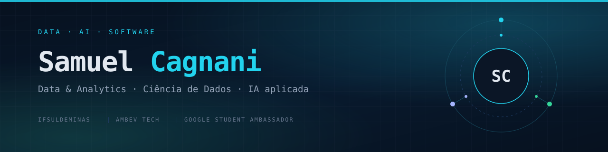
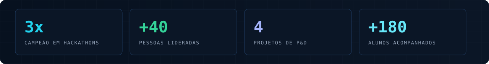

Transformo dados em decisão e construo soluções com <strong>IA aplicada</strong>, engenharia e visão de produto.

## 01 · Sobre

Sou técnico em Informática pelo IFSULDEMINAS e atualmente curso Engenharia de Computação na mesma instituição (formatura prevista para dezembro de 2027). Estou iniciando minha trajetória em **Data & Analytics na Ambev Tech** e gosto de transformar problemas reais em soluções que combinam dados, IA e engenharia de software.

Também atuo como **Google Student Ambassador de IA** e **Diretor de Projetos na Turing Junior Enterprise**, além de acumular experiência em pesquisa aplicada com **EMBRAPII** e **FAPEMIG**. Já liderei mais de 40 pessoas, venci três hackathons e desenvolvi soluções orientadas a dados, inovadoras e voltadas ao mercado.

## 02 · Stack

**Dados & IA**

**Engenharia & Cloud**

**Produto & Colaboração**

## 03 · Projetos em destaque

### Clara

**Agente de IA no WhatsApp** 
`Python` · `LLMs` · `WhatsApp API` · `CX`

Agente que traduz taxas e custos para lojistas, unindo dados de clientes, estratégia de experiência e prototipagem rápida.

> **1º lugar — 8º Hacka PagBank (2026)**

---

### RastroBão

**Rastreabilidade com Blockchain e IoT** 
`Blockchain` · `IoT` · `Rastreabilidade` · `Cadeia do café`

Solução descentralizada com Blockchain e IoT para rastreabilidade e segurança de dados da cadeia do café.

> **1º lugar — 7º Hackathon IFSULDEMINAS (2025)**

---

### ConectAí

**WhatsApp, IoT e automação inteligente.** 
`Python` · `Automação` · `WhatsApp API` · `IoT`

Uma solução integrada que transforma a gestão de CEASAs ao automatizar processos do pátio e da portaria via WhatsApp.

Ele conecta produtores e a administração pública em tempo real, eliminando o controle em papel e gerando transparência fiscal e eficiência.

> **1º lugar — 8º Hackathon IFSULDEMINAS (2026)**

---

### Umidade do Café com ML

**Pesquisa aplicada em agricultura digital** 
`Python` · `Pandas` · `Scikit-learn` · `Sensores` · `ETL`

Modelos preditivos para estimar a umidade do café durante a secagem industrial, a partir de fluxos contínuos de sensores e processamento de sinais.

> **P&D — EMBRAPII / IFSULDEMINAS**

---

### Controle de Acesso com Visão Computacional

**Integração de hardware e IA** 
`Python` · `OpenCV` · `OCR` · `Visão Computacional`

Engenharia reversa e integração entre equipamentos legados e controladores biométricos modernos, com OCR e reconhecimento facial.

> **P&D — FAPEMIG / CITUR / IFSULDEMINAS**

<a href="https://github.com/cagnani?tab=repositories"><strong>Explorar repositórios →</strong></a>

## 04 · Trajetória

<strong>Ambev Tech</strong> — Estágio em Data & Analytics <em>(2026 — atual)</em>

- Atuação em Data & Analytics, com foco em análise, modelagem e geração de valor a partir de dados.
- Desenvolvimento de soluções orientadas a dados em ambiente de tecnologia e escala.

<strong>Turing Junior Enterprise</strong> — Diretor de Projetos <em>(2025 — atual)</em>

- Liderança direta de 4 projetos simultâneos (Software, IoT, Dados e Inovação), coordenando 41 pessoas.
- Padronização de Kanban, milestones, sprints, issues e pull requests no GitHub.
- Interface com clientes: levantamento de requisitos, escopo técnico, cronogramas e qualidade.

`Scrum` · `Kanban` · `GitHub` · `Gestão de projetos`

<strong>Google</strong> — Student Ambassador de IA <em>(2026 — atual)</em>

- Workshops e palestras sobre IA Generativa, Google Gemini, LLMs e cultura AI-First.
- Orientação de estudantes em engenharia de prompt e arquitetura de agentes inteligentes.

`Gemini` · `LLMs` · `IA Generativa` · `Agentes`

<strong>EMBRAPII / IFSULDEMINAS</strong> — Pesquisador de P&D <em>(2025 — atual)</em>

- Modelos em Python para processamento de sinais e estimativa não destrutiva de umidade do café.
- Pipelines de dados, análise exploratória e modelagem preditiva em tempo real.

`Python` · `Pandas` · `Scikit-learn` · `Sensores` · `ETL`

<strong>FAPEMIG / CITUR / IFSULDEMINAS</strong> — Pesquisador de Visão Computacional <em>(2024 — 2025)</em>

- Engenharia reversa e integração de equipamentos legados a controladores biométricos Hikvision.
- Experimentos em visão computacional e OCR para extração automatizada de dados.
- Validação e parametrização de reconhecimento facial.

`Python` · `OpenCV` · `OCR` · `Visão Computacional`

<strong>IFSULDEMINAS</strong> — Tutor de Ensino a Distância <em>(2024 — 2025)</em>

- Acompanhamento acadêmico e técnico de 180 alunos em uma plataforma com mais de 600 participantes.
- Análise de logs e métricas de engajamento para identificação precoce e intervenção direcionada em alunos com risco de evasão.

`Analytics Educacional` · `Métricas de engajamento` · `Educação`

## 05 · Reconhecimentos

- **1º lugar — 8º Hacka PagBank (2026):** Clara, agente de IA no WhatsApp para transparência de taxas a lojistas.
- **1º lugar — 7º Hackathon IFSULDEMINAS (2025):** RastroBão, solução com Blockchain e IoT para rastreabilidade da cadeia do café.
- **1º lugar — 8º Hackathon IFSULDEMINAS (2026):** ConectAí, solução com WhatsApp e IoT para automatizar a gestão de CEASAs.
- **10ª colocação — Olimpíada Mineira de Programação (SBC 2026):** programação competitiva sob restrição de tempo e memória.

## 06 · GitHub em tempo real

Este perfil está em construção. Os números abaixo crescem a cada commit.

  

  <picture>
    <source media="(prefers-color-scheme: dark)" srcset="https://raw.githubusercontent.com/cagnani/cagnani/output/github-contribution-grid-snake-dark.svg" />
    <source media="(prefers-color-scheme: light)" srcset="https://raw.githubusercontent.com/cagnani/cagnani/output/github-contribution-grid-snake.svg" />
    
  </picture>

## 07 · Contato

Vamos conversar sobre dados, IA ou oportunidades?

  <a href="https://www.linkedin.com/in/samuelcagnani">LinkedIn</a> ·
  <a href="mailto:samuelcagnani0@gmail.com">E-mail</a> ·
  <a href="https://github.com/cagnani">GitHub</a>

Poços de Caldas, MG · Brasil

  Feito com dados, café e curiosidade.

